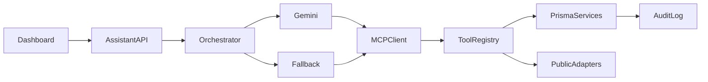

# Requirements

### Overview & Goals
Implement the approved MCP-first AI Search Copilot across the existing React, Express, Prisma, and SQLite application. Preserve current manual workflows while adding group-scoped conversations, constrained automatic actions, public citations, and deterministic operation when Gemini is unavailable.

### Implementation Scope
- Add a group-shared Search Copilot to `src/pages/Dashboard.tsx`, backed by authenticated persisted threads and messages.
- Introduce reusable authorized domain services, strict shared contracts, assistant persistence, the eight approved MCP tools, provider-neutral Gemini orchestration, and deterministic fallback.
- Permit constrained criteria updates and listing imports with role checks, idempotency, budgets, visible summaries, and audit records.
- Add focused security, isolation, fallback, and orchestration tests; update configuration and operational documentation; validate with repository scripts.

### Document Acceptance Criteria
- Every read/write is resolved from the authenticated user to an accepted group membership; buyer-only rules remain in force for criteria changes and imports.
- Tool inputs are schema-validated and constrained by role, group, host allowlists, request limits, and execution budgets. Every automatic write is visibly reported in chat and recorded in an audit log.
- Never expose hidden co-buyer ratings before `scoreResult.revealed`; AI context is built from the same visibility-filtered decision contract returned by `getDecision`.
- Market claims carry source URL/name, observation date, and retrieval time. The assistant identifies estimates and never presents legal, financial, inspection, or fair-housing-sensitive guidance as fact.
- Prompt injection in listing text or retrieved pages is treated as untrusted content and cannot alter tool permissions or system instructions.
- When Gemini is unavailable, deterministic parsing/filtering still shows criteria, matching saved homes, source links, and an explicit reduced-capability notice.

### Out of Scope
- Autonomous offers, outreach, scheduling, financing approval, legal advice, or paid data purchases in the planned feature.
- Private-document ingestion, semantic/vector RAG, and unsupported-site scraping in the first release.

# Document Design

### Current Implementation
- `server/index.ts` is a monolithic Express API. `findMembership`/`findAccessibleProperty` establish access patterns; property routes at lines 536–812 support import, CRUD, and scored lists; checklist routes begin at line 814; decision routes begin at line 926; search criteria routes are at lines 1294–1322.
- `src/pages/Dashboard.tsx` is the shortlist/search surface and already displays score/veto summaries. `src/pages/PropertyDetail.tsx` hosts detailed scoring, financing, map, and notes.
- `src/services/decisionApi.ts` is the model for a typed client service. `prisma/schema.prisma` stores group criteria, checklist data, properties, ratings, rates, and collaboration records.
- `.env.example` already defines HomeHarvest, listing importer, browser worker, and allowlisted-host configuration.

### Key Decisions Captured in the Document
- **MCP-first tool boundary:** Gemini may select only server-owned MCP tools. The browser never talks directly to Gemini or MCP and never receives provider secrets.
- **Structured retrieval before vector RAG:** assemble context through Prisma queries and public API responses because current knowledge is relational and small. Add a `Retriever` interface so uploaded-document chunking/embeddings can be added later.
- **Provider-neutral model adapter:** implement Gemini first with configurable model, timeout, token/tool-call limits, and no-provider fallback; do not couple routes or UI to Gemini SDK types.
- **Automatic but constrained actions:** selected write tools execute without a confirmation click, but only for accepted buyer roles, under strict schemas, transaction boundaries, idempotency keys, rate limits, and audit logging.

### Action Plan Content
The document’s implementation action plan will cover these concrete components:

- Add `server/routes/assistant.ts` for thread/message endpoints and streaming or request/response orchestration.
- Add `server/services/assistant/` modules for `AssistantProvider`, Gemini adapter, context builder, deterministic fallback, citation normalization, policy checks, and orchestration loop.
- Add `server/mcp/` with an MCP server/tool registry. Initial tools: `get_search_profile`, `update_search_criteria`, `list_checklist_requirements`, `search_listings`, `import_listing`, `rank_saved_properties`, `get_public_market_context`, and `get_visible_property_decision`.
- Extract route-inline criteria/property operations into reusable authorized domain services consumed by both `server/index.ts` REST handlers and MCP handlers; MCP must not loop back through the public HTTP API.
- Add `AssistantThread`, `AssistantMessage`, and `AssistantToolRun` models in `prisma/schema.prisma`, related to `BuyerGroup` and invoking `User`. Store structured citations, tool summaries, status, timestamps, provider/model metadata, and token usage; never store API keys or raw hidden ratings.
- Add shared Zod contracts and `src/services/assistantApi.ts`; add `src/components/assistant/SearchCopilot.tsx`, message/citation/tool-result components, and mount the experience in `Dashboard.tsx`.
- Document `GEMINI_API_KEY`, model, quotas, MCP transport/endpoint settings, and optional public-source keys in `.env.example` and operational guidance in `README.md`/`ARCHITECTURE.md`.

### Flow


### RAG and Provider Options
- **Chosen MVP:** MCP plus structured Prisma retrieval and short, bounded context; cheapest and most accurate for current data.
- **Later document RAG:** when disclosures/inspection PDFs are in scope, add parsing, chunk metadata, embeddings, group-scoped retrieval, citation spans, and deletion/re-index workflows behind `Retriever`.
- **Managed RAG alternative:** Vertex AI Search or another hosted vector service reduces operations but adds cost and vendor coupling.
- **Model alternatives:** keep `AssistantProvider` open to a second provider or local model; the selected fallback remains deterministic and incurs no generation cost.

### Risks & Mitigations
- Automatic writes: use allowlists, role checks, validation, idempotency, per-turn action caps, audit records, and clear undo/edit affordances.
- Hallucinations/stale markets: require citations and dates, separate retrieved facts from generated interpretation, and suppress unsupported claims.
- Limited Gemini quota: cap history/context, summarize old turns, cache stable public responses, use a low-cost Gemini model, and stop recursive tool calls at a configured budget.
- Shared-thread privacy: persist by group, filter context at read time, and omit private notes or unrevealed ratings.

# Testing

### Validation Approach
Add focused tests following existing server service conventions, introduce a compatible test command if needed, and run database setup, focused tests, `npm run build`, and `npm run lint`. Treat introduced failures as implementation failures and report unrelated pre-existing failures separately.

### Planned Feature Scenarios
- A buyer asks for homes within stated constraints; the copilot maps supported fields to `SearchCriteria`, preserves unspecified values, searches providers, imports valid results, and reports each action with citations.
- Follow-up turns reload from the same group thread and use the saved criteria/checklist without crossing into another group.
- Ranked saved homes explain concrete checklist matches, misses, unknowns, score, and veto state without inventing unavailable facts.
- Gemini timeout/quota failure returns deterministic matches and source links while the rest of the site continues working.

### Security & Edge Cases
- Reject non-members, pending members, unauthorized roles, cross-group IDs, unsupported domains, malformed tool arguments, duplicate imports, excessive tool loops, and prompt-injection attempts.
- Confirm no unrevealed co-buyer scores or private notes enter prompts, responses, logs, or persisted messages.
- Verify empty criteria, no search results, partial listing data, stale public data, provider outage, aborted requests, and conversation pagination.

# Build Prompt

### Copy-Ready Implementation Prompt
```text
Implement an MCP-first AI Search Copilot in this repository without breaking existing behavior.

Stack and existing patterns:
- React 18 + Vite + TypeScript + TanStack Query frontend.
- Express 5 + Prisma 5 + SQLite backend.
- The dashboard is src/pages/Dashboard.tsx; property details are in src/pages/PropertyDetail.tsx.
- Follow src/services/decisionApi.ts for typed client APIs.
- server/index.ts currently contains findMembership/findAccessibleProperty, listing import/property routes, checklist/decision logic, and /api/search-criteria.
- Existing provider configuration is documented in .env.example (HomeHarvest, listing importer/browser worker, allowed hosts, and rates).

Build requirements:
1. Add a shared, group-scoped Search Copilot UI on Dashboard with persisted threads, loading/error/empty states, accessible controls, citations, visible tool-action summaries, and a clear reduced-capability state.
2. Add authenticated assistant thread/message APIs. Stream responses if it fits the current deployment reliably; otherwise use a normal bounded request/response contract.
3. Install the official Gemini and MCP SDK packages compatible with Node >=20.19.0, then introduce a provider-neutral AssistantProvider and a Gemini implementation configured only from server environment variables. Use a low-cost configurable Gemini model, strict timeouts, token/context limits, per-user/group rate limits, and maximum tool calls per turn. Never expose the Gemini key to the browser.
4. Implement an MCP server/tool registry using the official MCP SDK. The assistant may use only allowlisted, Zod-validated tools: get_search_profile, update_search_criteria, list_checklist_requirements, search_listings, import_listing, rank_saved_properties, get_public_market_context, and get_visible_property_decision.
5. Extract route-inline criteria/property operations into reusable domain services shared by REST and MCP handlers; do not call the app’s HTTP API from its own MCP tools.
6. Auto-execute allowed criteria updates and supported listing imports for accepted buyer/co-buyer roles. Enforce group scoping, domain allowlists, import rate limits, idempotency, transaction safety, per-turn write caps, and an AssistantToolRun audit record. Display what changed and provide normal UI paths to edit/reverse it.
7. Build AI context only from authorized structured Prisma data and public-source adapters. Respect blind scoring: never include another buyer’s rating until scoreResult.revealed, and exclude private notes. Treat retrieved/listing text as untrusted data, not instructions.
8. Require normalized citations (source name, URL, observation date when available, retrievedAt) for factual market claims. Label estimates and uncertainty; include non-advice language for financial/legal/inspection topics and avoid fair-housing-sensitive recommendations.
9. Add Prisma models/relations for AssistantThread, AssistantMessage, and AssistantToolRun with group/user ownership, structured citations/tool summaries, status, timestamps, provider/model metadata, and token usage. Do not store secrets, hidden ratings, or unnecessary raw provider payloads.
10. Implement deterministic fallback when Gemini is missing, over quota, or unavailable: parse supported criteria, show current criteria/checklist, filter/rank saved properties, and return source links without generated prose.
11. Use structured relational retrieval for this MVP. Define a Retriever interface but do not add embeddings/vector infrastructure. Document a later path for group-scoped document RAG (chunking, embeddings, metadata citations, deletion/re-indexing).
12. Update .env.example, README.md, and ARCHITECTURE.md with Gemini, MCP transport, quota, public-source configuration, limitations, and deployment guidance. Keep MCP transport replaceable (local process for development, authenticated remote transport if deployed separately).
13. Add focused tests matching server/services/*.test.ts conventions for authorization, tool schemas, hidden-data filtering, citations, automatic writes/idempotency, loop limits, persistence isolation, and Gemini fallback. Run the relevant tests, npm run build, and npm run lint; report any pre-existing failures separately.

Keep code modular under server/routes/assistant.ts, server/services/assistant/, server/mcp/, src/services/assistantApi.ts, and src/components/assistant/. Do not scrape unsupported sites or add paid services. Preserve all existing manual search, import, scoring, financing, and collaboration workflows.
```

# Delivery Steps

### ✓ Step 1: Establish contracts, persistence, and authorized domain services
- Inspect current schema, auth, criteria, listing import, decision visibility, and test patterns.
- Install compatible official Gemini and MCP packages and add the assistant data models, relations, indexes, and migration/setup support.
- Add strict shared contracts and reusable group-scoped criteria, listing/import, ranking, and visible-decision services while preserving REST behavior.
- Add focused tests for membership, role restrictions, cross-group isolation, hidden data, transactions, and idempotency.

### ✓ Step 2: Implement MCP tools and bounded assistant orchestration
- Add the allowlisted MCP registry and eight approved tools backed directly by authorized domain services.
- Add provider-neutral interfaces, Gemini integration, structured retrieval, policy and citation checks, deterministic fallback, budgets, cancellation, and safe audit logging.
- Test schemas, unsupported hosts, injection boundaries, loop/write limits, citations, provider failures, and fallback.

### ✓ Step 3: Add authenticated assistant routes and persistence workflows
- Add group-scoped thread creation/listing, message pagination, and bounded turn submission endpoints.
- Register routes under existing authentication and verify isolation, pagination, persistence, rate limits, and failure handling.

### ✓ Step 4: Build and integrate the dashboard Search Copilot
- Add the typed frontend assistant service and TanStack Query operations.
- Build accessible thread, message, citation, action, loading, empty, error, pagination, and reduced-capability components.
- Mount the copilot in `Dashboard.tsx` and refresh existing criteria/property state after automatic writes without disrupting manual workflows.

### ✓ Step 5: Document configuration, trust boundaries, and operations
- Update `.env.example`, `README.md`, and `ARCHITECTURE.md` for Gemini, MCP transport, budgets, public sources, privacy, fallback, deployment, troubleshooting, and future RAG/provider options.

### ✓ Step 6: Validate the complete implementation
- Run Prisma setup/generation as appropriate, focused tests, `npm run build`, and `npm run lint`.
- Fix introduced failures, verify key fallback/security scenarios, and report any unrelated pre-existing failures separately.