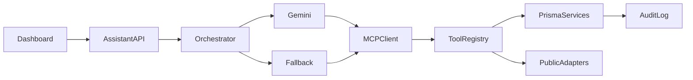

# AI Search Copilot Implementation Plan

## Purpose

This document records the approved plan for adding an AI Search Copilot to Home Buyer Sync. It is intended to be sufficient for a developer or coding agent to implement the feature later without relying on prior chat history.

This is a planning document only. Creating it does not install dependencies, change application behavior, alter the database, or implement the copilot.

## Approved First Release

The first release is a group-shared Search Copilot embedded in `src/pages/Dashboard.tsx`. It will:

- translate natural-language buyer requests into supported search criteria;
- use the group checklist, saved search criteria, saved properties, and visibility-filtered decision data as context;
- search approved listing providers and public, citable information sources;
- import supported listings and update search criteria automatically when authorized;
- persist conversations by buyer group/search so collaborators can revisit and continue them;
- report every automatic action and provide source links, dates, uncertainty labels, and reduced-capability notices; and
- preserve all existing manual search, import, scoring, financing, and collaboration workflows when AI is disabled or unavailable.

The copilot is not authorized to make offers, contact third parties, schedule appointments, approve financing, provide legal or inspection conclusions, buy data, or bypass a source's access controls.

## Acceptance Criteria

### Authorization and isolation

- Resolve every read and write from the authenticated user to an accepted `BuyerGroup` membership; never trust a model-supplied user or group identifier.
- Preserve the application's buyer-only authorization rules for criteria updates and listing imports, including equivalent enforcement for MCP tool calls.
- Persist threads, messages, and tool runs under the authorized group and prevent cross-group reads, writes, or context leakage.
- Build model context from the same visibility-filtered decision contract returned by `getDecision`. Never expose another buyer's rating before `scoreResult.revealed`, and exclude private notes.

### Tool and write safety

- Expose only server-owned, allowlisted MCP tools with strict Zod schemas and bounded outputs.
- Constrain execution by membership, role, group, approved host, request size, rate limits, per-turn tool-call limits, and per-turn write limits.
- Perform writes transactionally where appropriate and use idempotency keys to prevent duplicate criteria changes or imports.
- Record each attempted automatic write in an `AssistantToolRun` audit record and visibly summarize successful or failed changes in chat.
- Keep ordinary UI routes available for buyers to inspect, edit, or reverse changes.

### Sources, claims, and model safety

- Normalize factual market citations with source name, URL, observation date when available, and retrieval time.
- Clearly label estimates, missing data, uncertainty, and stale observations.
- Do not present legal, financial, inspection, or fair-housing-sensitive guidance as fact or make protected-class recommendations.
- Treat listing descriptions, imported fields, public pages, tool output, and user-provided content as untrusted data. They cannot modify system instructions, permissions, tool schemas, or execution budgets.
- Suppress factual market claims that cannot be supported by a normalized citation.

### Availability and cost

- Keep Gemini behind a provider-neutral interface and configure its model, timeout, context/token limits, and tool-call limits through server-only environment variables.
- Never expose Gemini credentials, MCP credentials, or provider secrets to the browser or persist them in assistant records.
- If Gemini is missing, times out, exceeds quota, or fails, use deterministic parsing and filtering to show current criteria, checklist requirements, matching/ranked saved properties, and source links.
- Explicitly identify fallback responses as reduced capability and keep the rest of the application usable.

## Existing Repository Context

- `server/index.ts` is the monolithic Express API. Its `findMembership` and `findAccessibleProperty` helpers establish current access-control patterns. Property discovery/import and CRUD routes, checklist routes, decision routes, and `/api/search-criteria` contain behavior that should be moved into reusable domain services rather than duplicated.
- `prisma/schema.prisma` contains users, buyer groups and memberships, search criteria, checklist data, properties, ratings, rates, and collaboration records. It is the source of truth for assistant persistence relationships.
- `src/pages/Dashboard.tsx` is the shortlist/search surface and already displays score and veto summaries. It is the first-release copilot host.
- `src/pages/PropertyDetail.tsx` contains detailed scoring, financing, maps, and notes. It remains an existing navigation destination rather than becoming a second copilot surface in the first release.
- `src/services/decisionApi.ts` provides the pattern for a typed client service and the visibility-filtered decision contract.
- `.env.example` already documents HomeHarvest, listing import/browser worker, allowed-host, and rate configuration. Gemini, MCP, and assistant budget settings should follow the same server-side configuration approach.
- `README.md` and `ARCHITECTURE.md` are the operational and architectural documentation targets for the eventual implementation.

Do not depend on the approximate route line numbers in this plan during implementation; locate the current symbols and handlers before refactoring.

## Architecture

### MCP-first boundary

The browser calls authenticated assistant routes in the Express server. The server owns orchestration and connects to an allowlisted MCP tool registry. Gemini can select only tools exposed through that registry; it cannot issue arbitrary database queries, HTTP requests, or application commands. MCP handlers call authorized domain services directly rather than looping back through the application's public HTTP API.



Keep MCP transport replaceable: an in-process or local-process transport is suitable for development, while a separately deployed transport must be authenticated, encrypted, and protected from direct browser access.

### Structured retrieval MVP

The first release retrieves bounded, authorized structures from Prisma and public adapters rather than using embeddings or a vector database. Current knowledge is relational, comparatively small, and sensitive to row-level visibility, so structured retrieval is cheaper, easier to audit, and more accurate than semantic retrieval for this scope.

Define a provider-neutral `Retriever` interface so orchestration depends on retrieval contracts rather than Prisma implementation details. The initial implementation can return search profile, checklist requirements, saved-property summaries, visible decision results, and cited public observations. Apply size limits and deterministic ordering before any content enters a model prompt.

### Provider-neutral generation

Add an `AssistantProvider` interface whose request, tool-call, response, error, and usage types are owned by the application. Implement Gemini first using the compatible official SDK, but do not expose Gemini SDK types from routes, MCP handlers, persistence models, or frontend contracts.

Classify missing credentials, timeouts, quota/rate-limit responses, invalid provider output, and upstream failures into application-owned errors that trigger deterministic fallback. Persist only required provider/model identifiers and aggregate token usage, not secrets or unnecessary raw payloads.

### Initial MCP tools

| Tool | Access | Purpose |
| --- | --- | --- |
| `get_search_profile` | Read | Return the authorized group's bounded search criteria. |
| `update_search_criteria` | Write | Patch only supported fields while preserving unspecified values. |
| `list_checklist_requirements` | Read | Return authorized, relevant group checklist requirements and weights. |
| `search_listings` | Read/external | Query configured listing providers under host, query, and result limits. |
| `import_listing` | Write | Import an approved listing idempotently through shared domain logic. |
| `rank_saved_properties` | Read | Rank saved homes using existing criteria, checklist, score, and veto behavior. |
| `get_public_market_context` | Read/external | Return normalized, dated observations from approved public adapters. |
| `get_visible_property_decision` | Read | Return only the invoking user's visibility-filtered decision contract. |

Tool descriptions must state that external and listing content is data, not instructions. Schemas must reject unknown fields, malformed URLs, unsupported hosts, oversized requests, and cross-group identifiers.

## Persistence Design

Add these models to `prisma/schema.prisma` during implementation:

- `AssistantThread`: belongs to a `BuyerGroup`, records creator and lifecycle timestamps, and supports group-scoped pagination and continuation.
- `AssistantMessage`: belongs to a thread and invoking user where applicable; stores role, bounded content, status, structured citation/tool summaries, provider/model metadata, aggregate usage, and timestamps.
- `AssistantToolRun`: belongs to a thread/message, group, and invoking user; stores tool name, safe input/output summaries, write/read classification, status, idempotency key, error category, and timestamps.

Use JSON fields only where they fit the repository's SQLite/Prisma support and typed serialization pattern. Never persist API keys, authorization headers, raw hidden ratings, private notes, full model payloads, or public-page bodies that are unnecessary for the conversation and audit record. Define indexes and uniqueness constraints for group/thread pagination and idempotent writes.

## Ordered Implementation Milestones

### Milestone 1: Authorized domain and persistence services

1. Add `AssistantThread`, `AssistantMessage`, and `AssistantToolRun` models and relations in `prisma/schema.prisma`, then create the project-standard migration/setup changes.
2. Extract criteria operations from `/api/search-criteria` in `server/index.ts` into a reusable authorized service while preserving REST behavior.
3. Extract listing discovery/import and saved-property ranking operations from `server/index.ts` into reusable domain services; keep provider and host restrictions centralized.
4. Add shared Zod contracts for assistant persistence, criteria patches, search inputs, imports, citations, tool summaries, and bounded pagination.
5. Add a context builder that accepts authenticated membership context and obtains visible decisions through the same filtering policy as `getDecision`.
6. Test accepted-membership enforcement, buyer role restrictions, cross-group isolation, hidden-rating/private-note exclusion, transactional writes, and idempotency.

Completion gate: existing REST routes retain their behavior, and direct service tests prove that neither group IDs nor hidden decision fields can be injected by callers.

### Milestone 2: MCP tools and orchestration

1. Add `server/mcp/` using the official MCP SDK and register only the eight initial tools listed above.
2. Have MCP handlers call the milestone-one services directly with server-derived authorization context; do not make internal HTTP calls to Express routes.
3. Add `server/services/assistant/` modules for application-owned provider contracts, Gemini integration, `Retriever`, structured context building, citation normalization, policy checks, deterministic fallback, and the bounded orchestration loop.
4. Enforce model timeout, token/context limits, maximum tool calls, maximum automatic writes, rate limits by user/group, approved hosts, output limits, and request cancellation.
5. Audit every tool run and return safe, visible action summaries. Keep sensitive details out of provider prompts, logs, errors, and stored messages.
6. Test malformed tool inputs, unsupported hosts, prompt-injection content, duplicate writes, recursive tool calls, citation rejection, provider timeout/quota, and deterministic fallback.

Completion gate: a service-level turn can use authorized tools, persist its audit trail, stop at all configured budgets, and produce useful deterministic output with Gemini absent.

### Milestone 3: Assistant API and dashboard experience

1. Add `server/routes/assistant.ts` with authenticated group-scoped endpoints for creating/listing threads, paginating messages, and submitting a turn. Use bounded request/response unless streaming is demonstrably reliable in the current deployment.
2. Register the router in `server/index.ts` without weakening existing middleware or access checks.
3. Add typed contracts and TanStack Query operations in `src/services/assistantApi.ts`, following `src/services/decisionApi.ts` conventions.
4. Add `src/components/assistant/SearchCopilot.tsx` and focused message, citation, tool-result/action, loading, empty, error, and fallback components.
5. Mount the copilot in `src/pages/Dashboard.tsx`; keep existing shortlist and manual search/import interactions intact.
6. Invalidate existing criteria and property queries after successful automatic writes. Show what changed, whether an action failed, and where the buyer can inspect or reverse it.
7. Ensure keyboard operation, labelled controls, readable status announcements, responsive layout, and conversation pagination.

Completion gate: accepted group members can resume shared threads, while automatic actions visibly refresh existing dashboard state and all non-AI behavior remains available.

### Milestone 4: Hardening, operations, and validation

1. Extend `.env.example` with server-only Gemini model/key settings, timeout and token/tool/write budgets, rate limits, MCP transport/endpoint authentication settings, and optional approved public-source keys.
2. Update `README.md` with setup, local operation, quota/fallback behavior, supported sources, limitations, privacy expectations, and troubleshooting.
3. Update `ARCHITECTURE.md` with assistant data flow, trust boundaries, MCP deployment choices, audit/persistence design, structured retrieval rationale, and future RAG/provider extension points.
4. Validate empty criteria, no matches, partial listing data, duplicate imports, stale public observations, unsupported domains, provider outages, quota exhaustion, aborted requests, and paginated conversations.
5. Run focused tests, `npm run db:setup` where appropriate for the schema change, `npm run build`, and `npm run lint`. Treat introduced failures as implementation failures and report unrelated pre-existing failures separately.

Completion gate: configuration and operational behavior are documented, focused security/fallback tests pass, and the repository's build and lint checks complete without introduced failures.

## Deterministic Fallback

Fallback is a supported execution path, not only an error message. It should:

1. parse only explicitly supported criteria from the user's request using deterministic rules;
2. preserve unspecified criteria values and apply authorized changes through the same validated MCP/domain service path;
3. return the current criteria and checklist requirements;
4. filter and rank saved properties using existing score/veto data visible to the user;
5. include approved listing/public source links already available from tools; and
6. state that Gemini is unavailable and generated interpretation or broader language understanding is reduced.

Fallback must obey the same authorization, tool schemas, write limits, idempotency, citations, audit logging, and hidden-data restrictions as provider-backed execution.

## Security and Privacy Checklist

- Derive identity and group membership from authenticated server context for every route, retrieval, and tool call.
- Require accepted membership and the correct buyer role for writes.
- Reject model-generated identity, group, role, permission, transport, and host overrides.
- Validate all tool inputs and outputs; reject unknown fields and cap text, arrays, history, results, and pagination.
- Use explicit host allowlists, safe redirects, timeouts, response-size limits, and SSRF protections for external adapters.
- Separate trusted instructions from untrusted content with typed message/tool boundaries.
- Use transactions and idempotency for writes, with a strict per-turn write cap.
- Log safe summaries and statuses, not secrets, raw provider bodies, private notes, or hidden ratings.
- Normalize and verify citations before presenting factual market claims.
- Include clear non-advice and uncertainty language where relevant.
- Ensure error messages and observability data do not disclose credentials or cross-group information.

## Validation Scenarios

- A buyer requests homes within stated constraints. Supported fields update while unspecified values remain unchanged; listing search/import actions are idempotent and visibly reported with citations.
- A collaborator resumes a saved thread and sees the group's history, but a pending member, non-member, or member of another group cannot read or modify it.
- Ranked saved homes identify concrete checklist matches, misses, unknowns, visible score, and veto state without inventing data or exposing unrevealed co-buyer ratings.
- A listing description or public page containing instructions cannot add tools, change permissions, bypass limits, or alter the system policy.
- An unsupported domain, malformed tool payload, excessive loop, duplicate import, or excessive write attempt is rejected and audited safely.
- Missing Gemini credentials, timeout, malformed output, or exhausted quota produces deterministic criteria/checklist/match results, links, and a reduced-capability notice.
- Empty criteria, no results, partial listings, stale sources, aborted requests, and thread pagination produce usable and bounded responses.

## Future Options (Not First-Release Scope)

### Group-scoped document RAG

When disclosures or inspection PDFs are explicitly brought into scope, implement parsing, chunk metadata, embeddings, group-scoped retrieval, citation spans, deletion, and re-indexing behind `Retriever`. Enforce authorization both when indexing and retrieving, and design retention and source-document deletion before storing vectors.

### Managed RAG

Vertex AI Search or another managed vector/retrieval service can reduce infrastructure work and improve scaling, but introduces recurring cost, data-governance review, and vendor coupling. It should remain an adapter behind `Retriever`, not become part of route or UI contracts.

### Second hosted provider

A second model provider can improve availability but adds cost, policy differences, credential management, and output normalization work. Add it behind `AssistantProvider` only after measuring Gemini failure frequency and fallback sufficiency.

### Local model

A local model may reduce per-request fees and data sent to hosted providers, but requires deployment capacity, model evaluation, patching, and reliable tool-calling behavior. It must use the same `AssistantProvider`, MCP allowlist, policy checks, budgets, and deterministic fallback.

None of these options should add private-document ingestion, embeddings, vector infrastructure, a second paid provider, or local inference to the first release.

## Copy-Ready Implementation Prompt

```text
Implement the approved MCP-first AI Search Copilot in this repository without breaking existing behavior.

Read AI_SEARCH_COPILOT_PLAN.md before changing code and use its acceptance criteria, ordered milestones, security checklist, fallback behavior, and first-release boundaries as requirements. Implement the milestones in order; do not add optional RAG or additional model providers to the first release.

Repository stack and existing patterns:
- Node >=20.19.0, TypeScript, React 18, Vite, TanStack Query, Express 5, Prisma 5, SQLite, and Zod 4.
- The shortlist/search surface is src/pages/Dashboard.tsx; detailed property scoring, financing, maps, and notes are in src/pages/PropertyDetail.tsx.
- Follow src/services/decisionApi.ts for typed frontend API patterns and preserve the visibility-filtered getDecision contract.
- server/index.ts currently contains findMembership/findAccessibleProperty, property discovery/import and CRUD, checklist and decision routes, and /api/search-criteria.
- prisma/schema.prisma stores users, buyer groups/memberships, search criteria, checklist data, properties, ratings, rates, and collaboration records.
- .env.example already covers HomeHarvest, listing import/browser worker, allowed hosts, and rate settings.
- README.md and ARCHITECTURE.md are the operational and architecture documentation sources.
- Current package.json validation scripts are npm run db:setup, npm run build, and npm run lint. There is currently no npm test script; add a compatible focused test script/command when adding tests, then run and document it.

Build requirements:
1. Add a shared, group-scoped Search Copilot to src/pages/Dashboard.tsx. Persist threads by buyer group/search and include loading, empty, error, pagination, citations, visible tool-action summaries, accessible controls, and a clear reduced-capability state. Preserve all existing dashboard and manual workflows.
2. Add AssistantThread, AssistantMessage, and AssistantToolRun models and appropriate relations, indexes, and idempotency constraints in prisma/schema.prisma. Store group/user ownership, bounded content, structured citation/tool summaries, status and timestamps, provider/model identifiers, and aggregate token usage. Never store secrets, authorization headers, raw hidden ratings, private notes, full model payloads, or unnecessary retrieved page bodies.
3. Extract route-inline search-criteria, listing discovery/import, and saved-property ranking behavior from server/index.ts into reusable authorized domain services shared by REST and MCP handlers. Preserve current REST behavior. MCP tools must call these services directly and must not loop back through the public HTTP API.
4. Add shared strict Zod contracts for assistant APIs, tool inputs/outputs, criteria patches, listing search/import, citations, audit summaries, and bounded pagination. Reject unknown fields, malformed URLs, oversized values, unsupported hosts, and caller/model-supplied cross-group identity.
5. Install official Gemini and MCP SDK packages that are compatible with Node >=20.19.0 and the existing package versions. Keep all provider and MCP credentials server-side. Do not expose secrets through Vite variables, browser responses, logs, persisted messages, or tool summaries.
6. Create server/mcp/ with a server/tool registry exposing only these tools: get_search_profile, update_search_criteria, list_checklist_requirements, search_listings, import_listing, rank_saved_properties, get_public_market_context, and get_visible_property_decision. Keep transport replaceable: local/in-process for development and authenticated encrypted remote transport only if deployed separately.
7. Derive user, accepted membership, group, and role from authenticated server context for every route and tool call. Preserve buyer-only rules for criteria changes and imports. Never trust identity, group, role, permission, host, or budget values proposed by the model.
8. Permit authorized criteria updates and listing imports to auto-execute without a confirmation click, but enforce strict schemas, transactions where appropriate, idempotency keys, approved-host and SSRF controls, per-user/group rate limits, request/result limits, per-turn tool-call limits, and per-turn write limits. Record every attempted tool action in AssistantToolRun and visibly report success or failure in chat with a normal UI path to inspect, edit, or reverse the change.
9. Create server/services/assistant/ modules for an application-owned AssistantProvider interface, Gemini adapter, Retriever interface, structured context builder, deterministic fallback, citation normalization, policy checks, and a bounded orchestration loop. Do not leak Gemini SDK types into routes, persistence, MCP handlers, or frontend contracts.
10. Configure Gemini only through server environment variables, including model, timeout, context/token limits, and tool-call limits. Prefer a low-cost configurable model suitable for the available license. Classify missing credentials, timeout, quota/rate-limit, malformed output, and upstream failure into application errors that activate fallback.
11. Use structured relational retrieval for this MVP: bounded Prisma queries plus approved public-source adapters. Build context from the same visibility-filtered decision policy as getDecision. Never reveal another buyer's rating before scoreResult.revealed and always exclude private notes. Define Retriever for future extensions, but do not add embeddings, vector storage, or private-document ingestion now.
12. Treat listing text, public pages, imported fields, user content, and tool output as untrusted data rather than instructions. They cannot change system policy, permissions, schemas, tools, hosts, or execution budgets. Separate trusted instructions and untrusted content using typed message/tool boundaries.
13. Normalize every factual market citation with source name, URL, observation date when available, and retrievedAt. Suppress unsupported factual claims; label estimates, uncertainty, missing data, and stale observations. Include non-advice language for legal, financial, and inspection topics, and do not make fair-housing-sensitive or protected-class recommendations.
14. Implement deterministic fallback for missing, unavailable, over-quota, timed-out, or invalid Gemini responses. Deterministically parse only supported criteria, preserve unspecified values, show current criteria/checklist, filter and rank visible saved properties, return approved source links, and explicitly state reduced capability. Apply the same authorization, validation, idempotency, write limits, citations, audit, and privacy controls as the Gemini path.
15. Add authenticated, group-scoped thread/message/turn routes in server/routes/assistant.ts and register them without weakening existing middleware. Prefer bounded request/response unless streaming is proven reliable in this deployment. Support cancellation and bounded conversation pagination.
16. Add typed contracts and TanStack Query operations in src/services/assistantApi.ts. Add modular components under src/components/assistant/, including SearchCopilot, message, citation, tool-result/action, empty, loading, error, and fallback states. Invalidate existing criteria/property queries after automatic writes and ensure keyboard access, labels, status announcements, and responsive behavior.
17. Add focused tests following the repository's server/services/*.test.ts conventions. Cover accepted membership and role checks, cross-group persistence isolation, tool schemas, unsupported hosts/SSRF boundaries, hidden-score and private-note filtering, prompt injection, citations, transactions, automatic-write idempotency, tool/write loop limits, provider failures, deterministic fallback, aborted requests, and pagination. Do not weaken or skip failing tests.
18. Update .env.example with server-only Gemini, assistant budget/rate-limit, MCP transport/authentication, and optional approved public-source settings. Update README.md with setup, supported sources, quota/fallback behavior, limitations, privacy, and troubleshooting. Update ARCHITECTURE.md with trust boundaries, data flow, MCP deployment choices, persistence/audit design, structured retrieval rationale, and extension interfaces.
19. Document future options without implementing them: group-scoped document RAG behind Retriever (parsing, chunks, embeddings, metadata citations, deletion/re-indexing), managed RAG such as Vertex AI Search, a second hosted provider behind AssistantProvider, and a local model behind AssistantProvider. State their cost, operations, privacy, and vendor-coupling trade-offs.
20. Validate empty criteria, no results, partial listings, duplicate imports, stale public observations, unsupported domains, provider outage/quota exhaustion, malformed model/tool output, cancellation, and conversation pagination. Run the focused test command added for this work, npm run db:setup, npm run build, and npm run lint. Fix all introduced failures and report any demonstrably pre-existing failures separately.

Keep the implementation modular under server/routes/assistant.ts, server/services/assistant/, server/mcp/, src/services/assistantApi.ts, and src/components/assistant/. Use the repository's existing style and patterns. Do not scrape unsupported sites, bypass access controls, purchase data, ingest private documents, add vector infrastructure, add a second provider, run a local model, make offers, contact third parties, schedule appointments, approve financing, or present legal/financial/inspection guidance as fact. Preserve existing search, import, scoring, financing, property-detail, and collaboration behavior when the assistant is disabled or unavailable.
```